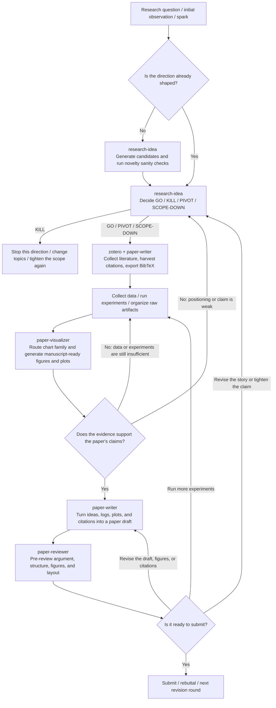

# Blackscience Tech Skills

[](./.codex-plugin/plugin.json)
[](./.claude-plugin/marketplace.json)
[](./skills)
[](./README.md#research-workflow)

Task-first agent skills for research, evaluation, developer tooling, and document workflows.

This repository distributes the same [`skills/`](./skills) tree in three practical ways:

- as a native Codex repo plugin
- as a generated Claude Code marketplace
- as a plain local skills directory for tools that read skill roots directly

The repository is intentionally project-owned. First-party skills live here; official or third-party skills should stay in their own upstream repositories instead of being vendored into this tree.

## At a Glance

| Item | Value |
| --- | --- |
| Main skill root | [`skills/`](./skills) |
| Codex distribution | [`.codex-plugin/plugin.json`](./.codex-plugin/plugin.json) + [`.agents/plugins/marketplace.json`](./.agents/plugins/marketplace.json) |
| Claude Code distribution | [`.claude-plugin/marketplace.json`](./.claude-plugin/marketplace.json) |
| External companion | [`anti-defensive-writing`](#external-companion-skill), installed separately from its pinned upstream source |
| Main focus areas | research, evaluation, developer tooling, documents |

## Install

Choose the shortest path for your environment.

### Codex App

Install this repository as a repo-local plugin when you already have the checkout on disk.

1. Clone the repository locally.
2. Open the repository in the Codex app.
3. Restart Codex if the repo was already open before the marketplace files existed.
4. Open the plugin directory, choose the `Blackscience Tech Skills` marketplace, and install the `Blackscience Tech Skills` plugin.

The Codex marketplace entry points at the repository root, so Codex loads [`.codex-plugin/plugin.json`](./.codex-plugin/plugin.json) and the existing [`skills/`](./skills) tree without an extra wrapper directory.

With the Codex CLI, register a local checkout once and install the plugin:

```sh
codex plugin marketplace add /path/to/skills
codex plugin add skills@blackscience-tech-skills
```

After updating that checkout, repeat `codex plugin add skills@blackscience-tech-skills`
to replace the cached plugin. For a Git-backed marketplace, use
`codex plugin marketplace upgrade blackscience-tech-skills`. To reproduce a Git
installation on another machine, register the same full commit:

```sh
codex plugin marketplace add https://github.com/tcztzy/skills --ref FULL_COMMIT_SHA
codex plugin add skills@blackscience-tech-skills
```

### Codex Remote Install

If you do not want to clone the repository first, install from the GitHub URL with `skill-installer`.

```text
Use $skill-installer to install skills from https://github.com/tcztzy/skills.
```

To install only one skill:

```text
Use $skill-installer to install the `skill-manager` skill from https://github.com/tcztzy/skills.
```

If a newly installed skill does not appear immediately, restart Codex.

### Claude Code Marketplace

This repository also exposes a Claude marketplace manifest at [`.claude-plugin/marketplace.json`](./.claude-plugin/marketplace.json).

After the repository is pushed to GitHub:

1. Add the repository as a marketplace in Claude Code.
2. Enable the individual plugins you want from that marketplace.

The generated catalog lists the bundled skills and any pinned companion entries
declared in [external-plugins.json](./.claude-plugin/external-plugins.json).

### Manual Local Roots

For a reader with configurable search roots, add the `skills/` directory of a
clean checkout at the desired commit. Adding and removing a skill there updates
what the reader discovers when it next scans the root.

If your reader uses a fixed directory, link each selected skill by name into
that directory. This POSIX example installs one skill and keeps existing entries:

```sh
REPO_ROOT=/absolute/path/to/skills
SKILL_ROOT="$HOME/.codex/skills"  # use the directory scanned by your reader
name=skill-manager
(
  set -eu
  test -f "$REPO_ROOT/skills/$name/SKILL.md"
  mkdir -p "$SKILL_ROOT"
  target="$SKILL_ROOT/$name"
  if [ -e "$target" ] || [ -L "$target" ]; then
    test "$target/SKILL.md" -ef "$REPO_ROOT/skills/$name/SKILL.md" ||
      { echo "Existing skill at $target" >&2; exit 1; }
  else
    ln -s "$REPO_ROOT/skills/$name" "$target"
  fi
)
```

When retiring a manually linked skill, remove its individual link after checking
its destination. On hosts without symlink support, use the plugin installer or a
reader with configurable search roots. Resolve commands shipped with a skill
relative to its installed `SKILL.md`, and resolve input files against the user's
project.

### External Companion Skill

`paper-writer` and `gpt-intervention` can use
[`anti-defensive-writing`](https://github.com/Kiterlin/anti-defensive-writing),
an MIT-licensed skill maintained by Kiterlin. Its source remains upstream rather
than being copied into this repository.

The reproducible version is commit
[`6345f09c9141be94df055fd048c94a4f26a8ed66`](https://github.com/Kiterlin/anti-defensive-writing/tree/6345f09c9141be94df055fd048c94a4f26a8ed66),
at `skill/anti-defensive-writing`. This is the version of the existing local
installation, not a floating reference to the latest upstream instructions.

- **Claude Code:** install `anti-defensive-writing@blackscience-tech-skills`
  from this marketplace. Its HTTPS Git source and full commit SHA are declared in
  `external-plugins.json`; the generated entry selects the upstream skill directory.
- **Codex:** install this companion separately into its skill root using the pinned
  Git steps below.
  The native repo plugin still contains only the 19 bundled skills. The pinned
  upstream repository has no Codex plugin manifest, so a remote plugin entry is
  not a substitute for installing the skill.
- **Other local skill-root consumers:** install the same pinned directory into
  the root that the application actually scans. A GitHub URL is source metadata,
  not a filesystem symlink.

For a fresh local installation, the following Git checkout and filesystem link
use the same fixed version. The checkout retains the upstream license. Choose the
application's actual skill root; Codex loads the shared `~/.agents/skills` root.
The commands stop rather than replace an existing source directory or installed skill:

```bash
(
  set -e
  SOURCE_ROOT="$HOME/.local/share/agent-skill-sources"
  SOURCE_DIR="$SOURCE_ROOT/anti-defensive-writing"
  SKILL_ROOT="$HOME/.agents/skills"
  test ! -e "$SKILL_ROOT/anti-defensive-writing"
  test ! -L "$SKILL_ROOT/anti-defensive-writing"
  mkdir -p "$SOURCE_ROOT" "$SKILL_ROOT"
  mkdir "$SOURCE_DIR"
  git -C "$SOURCE_DIR" init -q
  git -C "$SOURCE_DIR" remote add origin https://github.com/Kiterlin/anti-defensive-writing.git
  git -C "$SOURCE_DIR" fetch --depth=1 origin 6345f09c9141be94df055fd048c94a4f26a8ed66
  git -C "$SOURCE_DIR" checkout --detach FETCH_HEAD
  ln -s "$SOURCE_DIR/skill/anti-defensive-writing" "$SKILL_ROOT/anti-defensive-writing"
)
```

If the skill is already installed, keep that installation and compare it before
choosing any update; do not replace local edits.
An existing `skills/anti-defensive-writing` symlink may remain as a local mount
and is ignored by Git. Portable provenance is the upstream URL, directory, and
commit above, not the mount's machine-specific path. Updating the pin is an
explicit dependency update and should be checked against the installed version.

## Skill Map

The catalog is organized around user tasks instead of tool brands.

| Track | What it covers | Representative skills |
| --- | --- | --- |
| Research strategy | idea generation, novelty checks, go/kill/pivot decisions | [`research-idea`](./skills/research-idea/SKILL.md) |
| Paper production | literature, figures, drafting, review, translation | [`zotero`](./skills/zotero/SKILL.md), [`paper-writer`](./skills/paper-writer/SKILL.md), [`paper-visualizer`](./skills/paper-visualizer/SKILL.md), [`paper-reviewer`](./skills/paper-reviewer/SKILL.md), [`academic-zh-en-translation`](./skills/academic-zh-en-translation/SKILL.md) |
| Experiment and evaluation | benchmark design and scoring | [`benchmark-builder`](./skills/benchmark-builder/SKILL.md) |
| Engineering and systems | documentation-driven development, Python style, infra, and batch systems | [`ddd`](./skills/ddd/SKILL.md), [`modern-python-style`](./skills/modern-python-style/SKILL.md), [`hpc-operator`](./skills/hpc-operator/SKILL.md), [`nix`](./skills/nix/SKILL.md) |
| Authoring and workflow maintenance | skill audits, format conversion, and document authoring | [`skill-manager`](./skills/skill-manager/SKILL.md), [`latex-to-word`](./skills/latex-to-word/SKILL.md), [`typst`](./skills/typst/SKILL.md) |

<details>
<summary>Full installable catalog</summary>

### Research and paper workflows

- [`academic-zh-en-translation`](./skills/academic-zh-en-translation/SKILL.md): academic Chinese-English translation with fidelity and discipline-aware wording
- [`figure-to-prompt`](./skills/figure-to-prompt/SKILL.md): inspect figure–text alignment and write grounded reconstruction or redesign prompts
- [`paper-reviewer`](./skills/paper-reviewer/SKILL.md): bounded academic paper review with structured outputs
- [`paper-visualizer`](./skills/paper-visualizer/SKILL.md): publication-grade figures, plots, and diagrams
- [`paper-writer`](./skills/paper-writer/SKILL.md): drafting, revising, scaffolding, citation harvesting, and figure QA
- [`research-idea`](./skills/research-idea/SKILL.md): idea generation, novelty checks, research triage, and positioning
- [`zotero`](./skills/zotero/SKILL.md): literature capture, collection management, and bibliography export

### Experiment and evaluation workflows

- [`benchmark-builder`](./skills/benchmark-builder/SKILL.md): benchmark items, rubrics, evaluators, and release protocols
- [`evo2-opengenome2`](./skills/evo2-opengenome2/SKILL.md): Evo 2 inference and training workflows, OpenGenome2 data access, and large-download checks

### Engineering, infra, and environment workflows

- [`ddd`](./skills/ddd/SKILL.md): make code tasks documentation-driven with routing-useful file contracts
- [`hpc-operator`](./skills/hpc-operator/SKILL.md): operate and troubleshoot LSF jobs, arrays, queues, and execution hosts
- [`modern-python-style`](./skills/modern-python-style/SKILL.md): apply Python syntax and typing policies through project checks
- [`nix`](./skills/nix/SKILL.md): validate Nix modules, flakes, packages, and build purity
- [`overengineering`](./skills/overengineering/SKILL.md): reduce avoidable implementation and workflow costs under the same requirements

### Documents, authoring, and workflow maintenance

- [`gpt-intervention`](./skills/gpt-intervention/SKILL.md): preserve task intent, check consequential choices, and verify delivered outcomes
- [`latex-to-word`](./skills/latex-to-word/SKILL.md): automated LaTeX-to-Word conversion with preprocessing
- [`raster-to-vector`](./skills/raster-to-vector/SKILL.md): reconstruct raster diagrams as editable vector graphics
- [`skill-manager`](./skills/skill-manager/SKILL.md): audit skill scope, overlapping responsibilities, and useful decision guidance
- [`typst`](./skills/typst/SKILL.md): draft, convert, debug, and validate Typst documents

</details>

## Research Workflow

The repository is strongest when multiple research-oriented skills are composed into one loop instead of used as isolated one-off tools.



Recommended minimum loop:

1. [`research-idea`](./skills/research-idea/SKILL.md)
2. [`zotero`](./skills/zotero/SKILL.md) or [`paper-writer`](./skills/paper-writer/SKILL.md) for bibliography work
3. [`paper-visualizer`](./skills/paper-visualizer/SKILL.md)
4. [`paper-writer`](./skills/paper-writer/SKILL.md)
5. [`paper-reviewer`](./skills/paper-reviewer/SKILL.md)

The intended operating model is:

- decide whether the story is worth pursuing before drafting
- summarize experiment artifacts before turning them into prose
- use one visualization entry point instead of splitting by plotting backend
- use one manuscript-writing entry point instead of fragmenting adjacent paper tasks
- run a bounded review pass before submission

## Repository Layout

- [`skills/`](./skills): all discoverable skills
- [`skills/<skill-name>/`](./skills): installable skills when the directory contains `SKILL.md`
- helper-only directories may exist under [`skills/`](./skills) without being exported as installable entries

## Metadata and Maintenance

Repository metadata is split by consumer:

- [`.codex-plugin/plugin.json`](./.codex-plugin/plugin.json): native Codex plugin manifest
- [`.agents/plugins/marketplace.json`](./.agents/plugins/marketplace.json): Codex marketplace entry for this repository
- [`.claude-plugin/marketplace.json`](./.claude-plugin/marketplace.json): Claude marketplace manifest generated from skill metadata
- [`.claude-plugin/external-plugins.json`](./.claude-plugin/external-plugins.json): pinned remote Claude entries for separately maintained companion skills

When changing a skill, regenerate its catalog and check the published paths:

```sh
python3 scripts/generate_claude_marketplace.py
python3 scripts/validate_plugin_metadata.py
```

In a Git checkout the generator includes tracked and new non-ignored skill
directories. A clean source archive uses its packaged directories. For a
reproducible checkout record the full SHA from `git rev-parse HEAD`.

For a release that changes bundled skills, increment the numeric
`MAJOR.MINOR.PATCH` version in the Codex manifest. Compare against the previous
release commit (or the pull request base):

```sh
python3 scripts/check_plugin_release.py --base PREVIOUS_COMMIT
```

This compares the skill names and checks active references to retired names. For
an intentional rename or merge, send a typical request to the replacement and
check the resulting artifact. For a new executable workflow, run one example
from a separate project directory and check the result with and without its
declared dependencies. Keep special hardware, credentials and optional downloads
scoped to the workflows that use them.

Reproduce the full CI test suite with Python 3.12.13, Pandoc 3.13 and pdfLaTeX
(including the journal classes). The first tokenizer run needs a network connection
or a populated tiktoken cache. The core suite needs only Python and Git:

```sh
python scripts/run_tests.py --core
python -m pip install -r scripts/test-requirements.txt
python scripts/run_tests.py
```

## Repository Conventions

- Use precise, professional English unless a skill is explicitly language-specific.
- Keep top-level skills task-first rather than tool-first whenever possible.
- Keep upstream official skills such as `playwright`, `pdf`, or `openai-docs` in their original source repositories or use the built-in system skills that ship with Codex.
