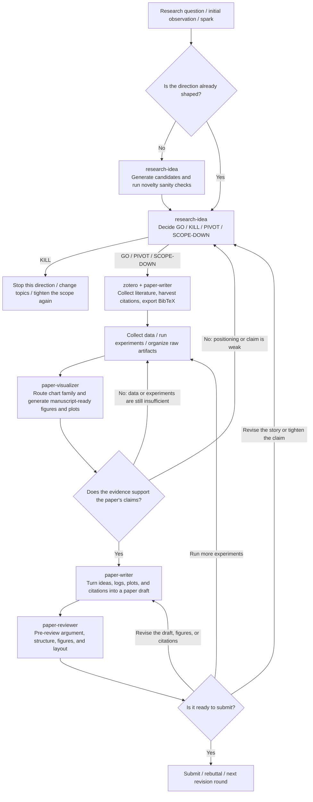

# Blackscience Tech Skills

[](./.codex-plugin/plugin.json)
[](./.claude-plugin/marketplace.json)
[](./skills)
[](./skills)
[](./README.md#research-workflow)

Task-first agent skills for research, evaluation, developer tooling, and document workflows.

This repository distributes the same [`skills/`](./skills) tree in three practical ways:

- as a native Codex repo plugin
- as a generated Claude Code marketplace
- as a plain local skills directory for tools that read skill roots directly

The repository is intentionally project-owned. First-party skills live here; official or third-party skills should stay in their own upstream repositories instead of being vendored into this tree.

## At a Glance

| Item | Value |
| --- | --- |
| Main skill root | [`skills/`](./skills) |
| Codex distribution | [`.codex-plugin/plugin.json`](./.codex-plugin/plugin.json) + [`.agents/plugins/marketplace.json`](./.agents/plugins/marketplace.json) |
| Claude Code distribution | [`.claude-plugin/marketplace.json`](./.claude-plugin/marketplace.json) |
| Current catalog size | 17 installable skills |
| Main focus areas | research, evaluation, developer tooling, documents |

## Install

Choose the shortest path for your environment.

### Codex App

Install this repository as a repo-local plugin when you already have the checkout on disk.

1. Clone the repository locally.
2. Open the repository in the Codex app.
3. Restart Codex if the repo was already open before the marketplace files existed.
4. Open the plugin directory, choose the `Blackscience Tech Skills` marketplace, and install the `Blackscience Tech Skills` plugin.

The Codex marketplace entry points at the repository root, so Codex loads [`.codex-plugin/plugin.json`](./.codex-plugin/plugin.json) and the existing [`skills/`](./skills) tree without an extra wrapper directory.

### Codex Remote Install

If you do not want to clone the repository first, install from the GitHub URL with `skill-installer`.

```text
Use $skill-installer to install skills from https://github.com/tcztzy/skills.
```

To install only one skill:

```text
Use $skill-installer to install the `skill-manager` skill from https://github.com/tcztzy/skills.
```

If a newly installed skill does not appear immediately, restart Codex.

### Claude Code Marketplace

This repository also exposes a Claude marketplace manifest at [`.claude-plugin/marketplace.json`](./.claude-plugin/marketplace.json).

After the repository is pushed to GitHub:

1. Add the repository as a marketplace in Claude Code.
2. Enable the individual plugins you want from that marketplace.

The Claude manifest is generated from the installable skill directories under [`skills/`](./skills), so the plugin list stays aligned with the repository contents.

### Manual Local Roots

If you prefer direct filesystem-based loading, point your local skill roots at this repository's [`skills/`](./skills) directory.

```bash
REPO_ROOT=/path/to/tcztzy-skills
ln -sfn "$REPO_ROOT/skills" "$HOME/.codex/skills"
ln -sfn "$REPO_ROOT/skills" "$HOME/.claude/skills"
```

That keeps skill lookup stable for repository-local helpers such as:

- `$CODEX_HOME/skills/skill-manager/scripts/validate-skill.py`
- `$CODEX_HOME/skills/paper-visualizer/scripts/manuscript_figure.py`

The same layout is also suitable for OpenClaw-compatible workflows that read a `skills/` directory directly.

## Skill Map

The catalog is organized around user tasks instead of tool brands.

| Track | What it covers | Representative skills |
| --- | --- | --- |
| Research strategy | idea generation, novelty checks, go/kill/pivot decisions | [`research-idea`](./skills/research-idea/SKILL.md) |
| Paper production | literature, figures, drafting, review, translation | [`zotero`](./skills/zotero/SKILL.md), [`paper-writer`](./skills/paper-writer/SKILL.md), [`paper-visualizer`](./skills/paper-visualizer/SKILL.md), [`paper-reviewer`](./skills/paper-reviewer/SKILL.md), [`academic-zh-en-translation`](./skills/academic-zh-en-translation/SKILL.md) |
| Experiment and evaluation | benchmark design and scoring | [`benchmark-builder`](./skills/benchmark-builder/SKILL.md) |
| Engineering and systems | documentation-driven development, Python style, infra, and batch systems | [`ddd`](./skills/ddd/SKILL.md), [`modern-python-style`](./skills/modern-python-style/SKILL.md), [`hpc-operator`](./skills/hpc-operator/SKILL.md), [`nix`](./skills/nix/SKILL.md) |
| Authoring and workflow maintenance | skill audits, format conversion, and document authoring | [`skill-manager`](./skills/skill-manager/SKILL.md), [`latex-to-word`](./skills/latex-to-word/SKILL.md), [`typst`](./skills/typst/SKILL.md) |

<details>
<summary>Full installable catalog</summary>

### Research and paper workflows

- [`academic-zh-en-translation`](./skills/academic-zh-en-translation/SKILL.md): academic Chinese-English translation with fidelity and discipline-aware wording
- [`figure-to-prompt`](./skills/figure-to-prompt/SKILL.md): inspect figure–text alignment and write grounded reconstruction or redesign prompts
- [`paper-reviewer`](./skills/paper-reviewer/SKILL.md): bounded academic paper review with structured outputs
- [`paper-visualizer`](./skills/paper-visualizer/SKILL.md): publication-grade figures, plots, and diagrams
- [`paper-writer`](./skills/paper-writer/SKILL.md): drafting, revising, scaffolding, citation harvesting, and figure QA
- [`research-idea`](./skills/research-idea/SKILL.md): idea generation, novelty checks, research triage, and positioning
- [`zotero`](./skills/zotero/SKILL.md): literature capture, collection management, and bibliography export

### Experiment and evaluation workflows

- [`benchmark-builder`](./skills/benchmark-builder/SKILL.md): benchmark items, rubrics, evaluators, and release protocols
- [`evo2-opengenome2`](./skills/evo2-opengenome2/SKILL.md): Evo 2 inference and training workflows, OpenGenome2 data access, and large-download checks

### Engineering, infra, and environment workflows

- [`ddd`](./skills/ddd/SKILL.md): make code tasks documentation-driven with routing-useful file contracts
- [`hpc-operator`](./skills/hpc-operator/SKILL.md): operate and troubleshoot LSF jobs, arrays, queues, and execution hosts
- [`modern-python-style`](./skills/modern-python-style/SKILL.md): apply Python syntax and typing policies through project checks
- [`nix`](./skills/nix/SKILL.md): validate Nix modules, flakes, packages, and build purity

### Documents, authoring, and workflow maintenance

- [`latex-to-word`](./skills/latex-to-word/SKILL.md): automated LaTeX-to-Word conversion with preprocessing
- [`raster-to-vector`](./skills/raster-to-vector/SKILL.md): reconstruct raster diagrams as editable vector graphics
- [`skill-manager`](./skills/skill-manager/SKILL.md): audit skill scope, overlapping responsibilities, and useful decision guidance
- [`typst`](./skills/typst/SKILL.md): draft, convert, debug, and validate Typst documents

</details>

## Research Workflow

The repository is strongest when multiple research-oriented skills are composed into one loop instead of used as isolated one-off tools.



Recommended minimum loop:

1. [`research-idea`](./skills/research-idea/SKILL.md)
2. [`zotero`](./skills/zotero/SKILL.md) or [`paper-writer`](./skills/paper-writer/SKILL.md) for bibliography work
3. [`paper-visualizer`](./skills/paper-visualizer/SKILL.md)
4. [`paper-writer`](./skills/paper-writer/SKILL.md)
5. [`paper-reviewer`](./skills/paper-reviewer/SKILL.md)

The intended operating model is:

- decide whether the story is worth pursuing before drafting
- summarize experiment artifacts before turning them into prose
- use one visualization entry point instead of splitting by plotting backend
- use one manuscript-writing entry point instead of fragmenting adjacent paper tasks
- run a bounded review pass before submission

## Repository Layout

- [`skills/`](./skills): all discoverable skills
- [`skills/<skill-name>/`](./skills): installable skills when the directory contains `SKILL.md`
- helper-only directories may exist under [`skills/`](./skills) without being exported as installable entries

## Metadata and Maintenance

Repository metadata is split by consumer:

- [`.codex-plugin/plugin.json`](./.codex-plugin/plugin.json): native Codex plugin manifest
- [`.agents/plugins/marketplace.json`](./.agents/plugins/marketplace.json): Codex marketplace entry for this repository
- [`.claude-plugin/marketplace.json`](./.claude-plugin/marketplace.json): Claude marketplace manifest generated from skill metadata

Regenerate the Claude marketplace after adding, removing, renaming, or updating installable skills:

Run these commands from a Git checkout. The generator includes tracked and new
non-ignored skills, so private local skills excluded by Git are not published.

```bash
python3 scripts/generate_claude_marketplace.py
```

Validate both Codex and Claude plugin metadata before pushing:

```bash
python3 scripts/validate_plugin_metadata.py
```

## Repository Conventions

- Use precise, professional English unless a skill is explicitly language-specific.
- Keep top-level skills task-first rather than tool-first whenever possible.
- Keep upstream official skills such as `playwright`, `pdf`, or `openai-docs` in their original source repositories or use the built-in system skills that ship with Codex.
